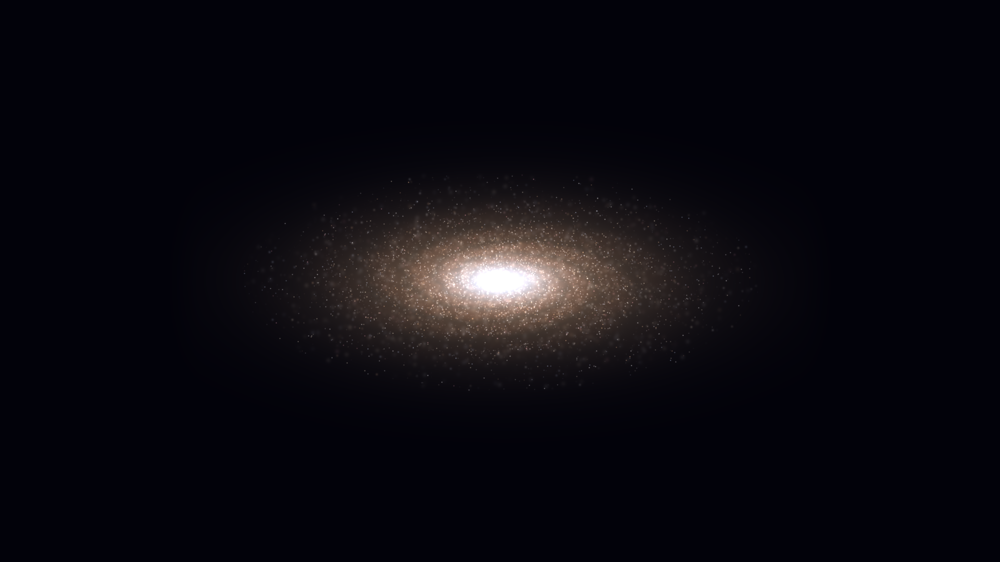
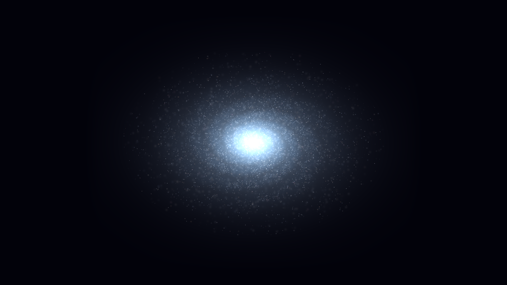
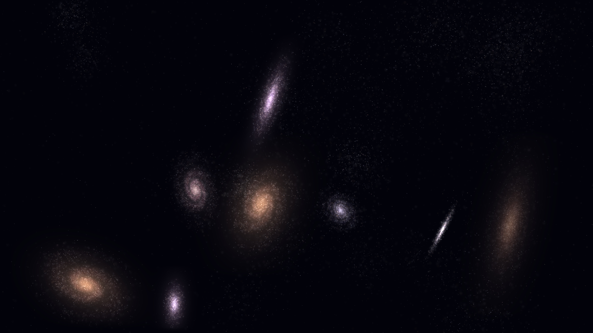
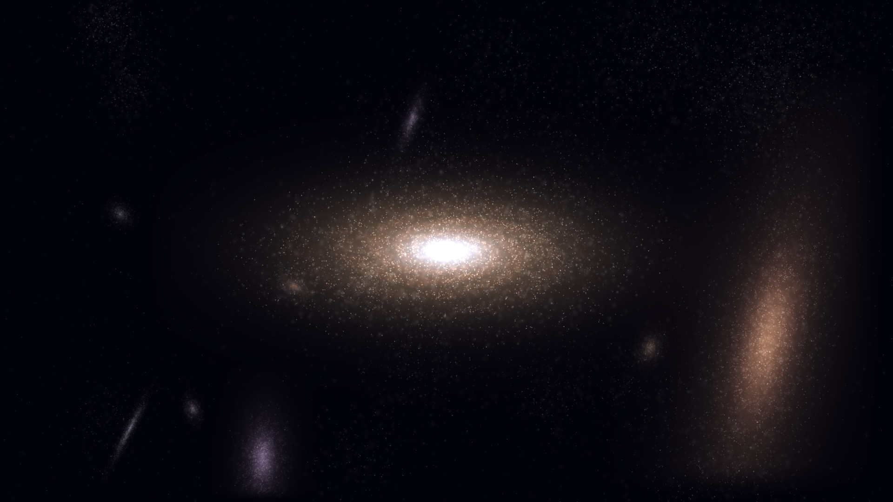
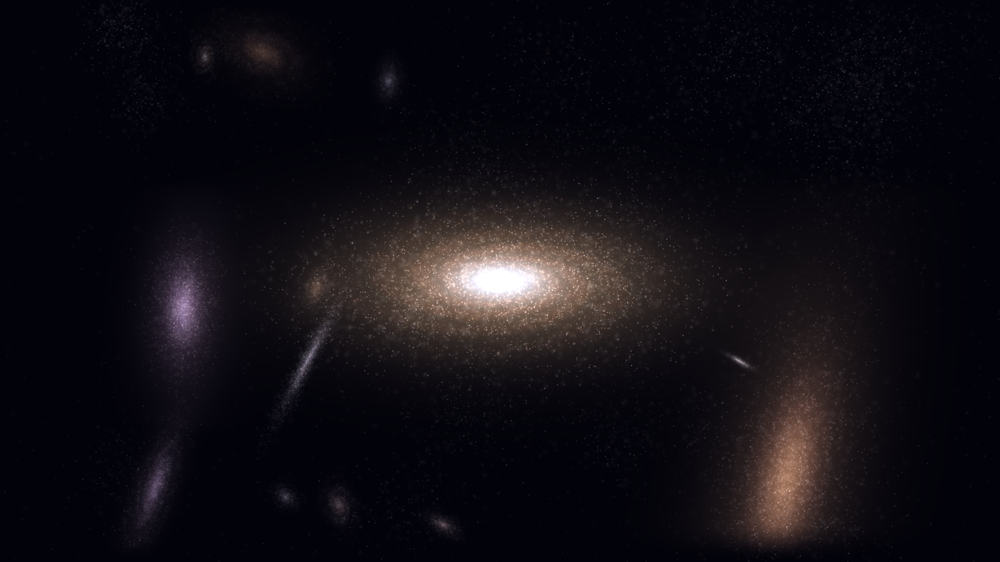
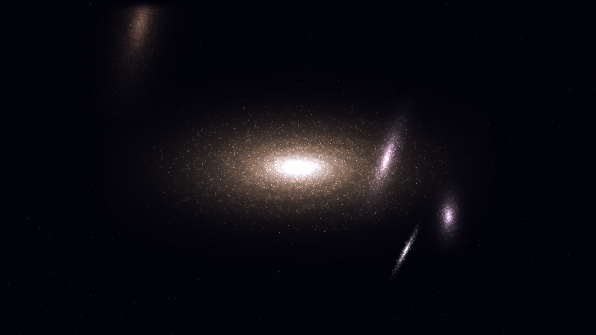
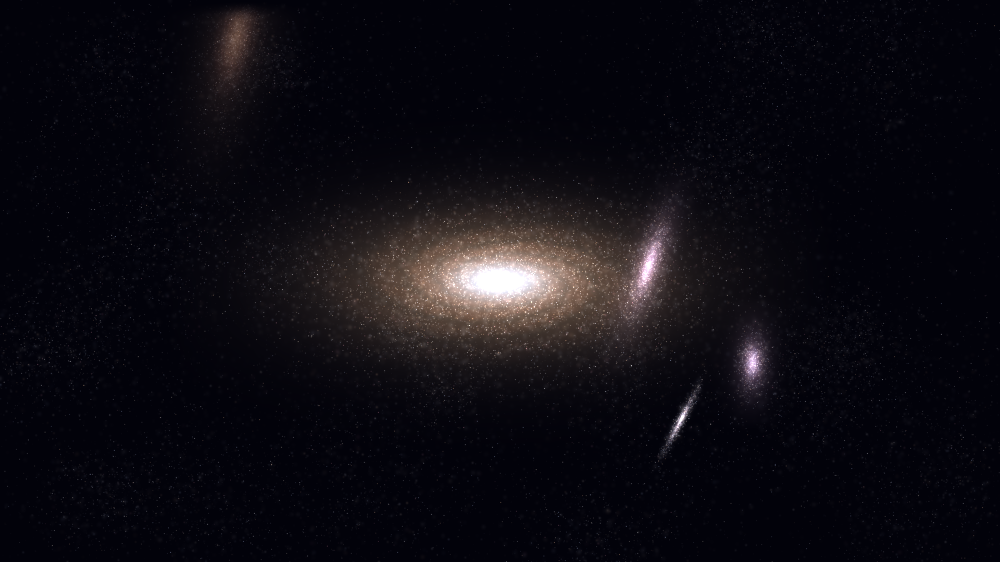
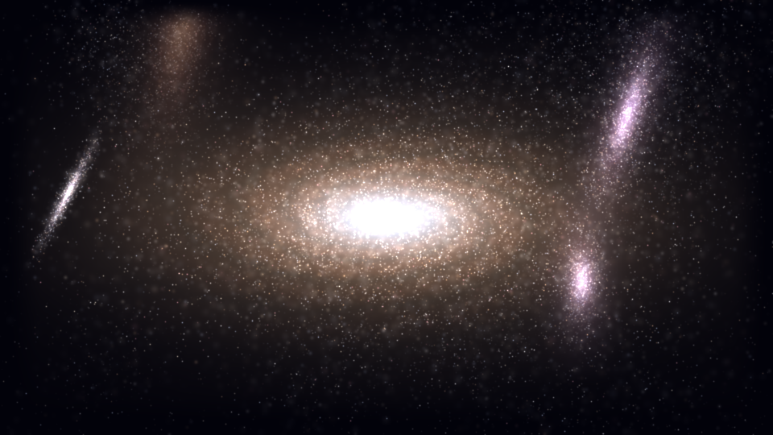

# galaxy.py

Процедурная генерация космоса: одна большая галактика + N далёких на фоне звёздного неба.

## Установка

```bash
pip install -r requirements.txt
```

## Быстрый старт

Скрипт умеет две вещи: **рендерить одну картинку** (превью кадра) и **собирать видео** (анимированное MP4).

### Фото — один кадр

```bash
python galaxy.py preview -t 0 -o preview.png
```

- `-t 0` — номер кадра, который хотите отрендерить (`0 … FRAMES-1`).
- `-o preview.png` — имя выходного файла. Если не указать, сохранится как `galaxy_t00.png`.

Данная команда нужна для быстрой проверки параметров перед рендером видеофайла: рендер одного кадра занимает секунды.

### Видео — вся анимация

```bash
python galaxy.py video
```

- По умолчанию: **1920×1080**, **180 кадров**, **15 fps** → примерно 12 секунд видео.
- Результат: `galaxy.mp4` в текущей папке.
- Чтобы переименовать — добавьте `-o my_video.mp4`.

## Проверка после установки

Две команды, чтобы убедиться, что всё работает:

```bash
# Фото: должно появиться test.png (10–15 секунд)
python galaxy.py preview -t 0 -o test.png

# Видео: короткий тест на 30 кадров
python galaxy.py video --n-far 2 --depth-mode geometric -n 30 -o test.mp4
```

Если оба файла появились и открываются — всё в порядке.

## Примеры

### Главная галактика

```bash
# Только главная, без далёких галактик и фоновых звёзд — чистая спираль
python galaxy.py preview -t 0 --n-far 0 --field-stars 0 -o example_main.png
```



```bash
# Другая палитра и более крутой наклон
python galaxy.py preview -t 0 --n-far 0 --field-stars 0 --main-palette 3 --main-tilt 45 -o example_main_palette3.png
```



### Только далёкие галактики

```bash
# Без главной: много маленьких галактик на фоне
python galaxy.py preview -t 0 --no-main --n-far 8 -o example_far_only.png
```



### Глубина — галактики уходят вдаль

```bash
# Геометрическая: каждая следующая мельче предыдущей
python galaxy.py preview -t 0 --n-far 8 --depth-mode geometric --depth-ratio 0.62 -o example_depth_geometric.png
```



```bash
# Степенная: более плавное затухание
python galaxy.py preview -t 0 --n-far 12 --depth-mode power --depth-power 2.2 -o example_depth_power.png
```



### Фоновое звёздное небо

```bash
# Редкое небо без кластеров — ровные одиночные звёзды
python galaxy.py preview -t 0 --field-stars 5000 --field-no-clusters -o example_field_sparse.png
```



```bash
# Плотное небо с кластерами
python galaxy.py preview -t 0 --field-stars 40000 -o example_field_dense.png
```



### Низкое разрешение для быстрых тестов

```bash
# 960×540 — рендерится в разы быстрее, картинка меньше
python galaxy.py preview -t 0 -W 960 -H 540 -o example_small.png
```



## Как это работает

1. **Главная галактика** — спиральная, с туманностью, ядром и звёздами. Параметры: `--main-*`.
2. **Далёкие галактики** — N штук, случайно размещённых на фоне. Параметры: `--n-far`, `--far-*`, `--depth-*`.
3. **Фоновое звёздное небо** — по умолчанию 20000 звёзд, 85% из них собраны в кластеры (как настоящие звёздные скопления). Число настраивается флагом `--field-stars`.

Всё рисуется **аддитивно** (сложение цветов), поэтому туманность, звёзды и фон не перекрывают друг друга, а складываются — как в реальной астрофотографии.

## Все параметры

```bash
python galaxy.py --help
```

Группы параметров:

| Группа | Флаги |
|---|---|
| Главная галактика | `--main-scale`, `--main-bright`, `--main-tilt`, `--main-palette`, `--main-arms`, `--main-disk`, `--main-core-ratio`, `--main-x`, `--main-y` |
| Далёкие галактики | `--n-far`, `--far-scale-min/max`, `--far-bright-min/max`, `--far-tilt-min/max`, `--far-arms-min/max`, `--far-disk-min/max`, `--separation` |
| Глубина | `--depth-mode`, `--depth-start`, `--depth-ratio`, `--depth-power`, `--depth-jitter`, `--depth-min-scale` |
| Пульсация ядра | `--pulse-freq-min/max`, `--pulse-depth-min/max`, `--main-pulse-freq`, `--main-pulse-depth`, `--no-pulse` |
| Фоновые звёзды | `--field-stars`, `--field-cluster-frac`, `--field-cluster-radius`, `--field-cluster-size-min/max`, `--field-no-clusters` |
| Размер и время | `-W`, `-H`, `-n`, `--fps`, `--slowdown` |
| Прочее | `--seed`, `--no-main` |

## Заметки

- **Разрешение.** По умолчанию 1920×1080. Для быстрых тестов используйте `-W 960 -H 540`.
- **Bbox-оптимизация.** Рисуются только те области, где реально есть галактика — это сильно ускоряет рендер.
- **`scipy` опционален.** Без него звёзды будут резче (без гауссова размытия) — это fallback, а не ошибка.
- **ffmpeg.** Для видео нужен `ffmpeg`; `imageio-ffmpeg` скачает его автоматически при первом запуске.
- **Детерминированность.** Все случайности через `seed` — один и тот же `--seed 42` даёт одну и ту же картинку.

## Требования

- Python 3.9+
- numpy, pillow, imageio, imageio-ffmpeg
- scipy — опционально (для мягких звёзд)